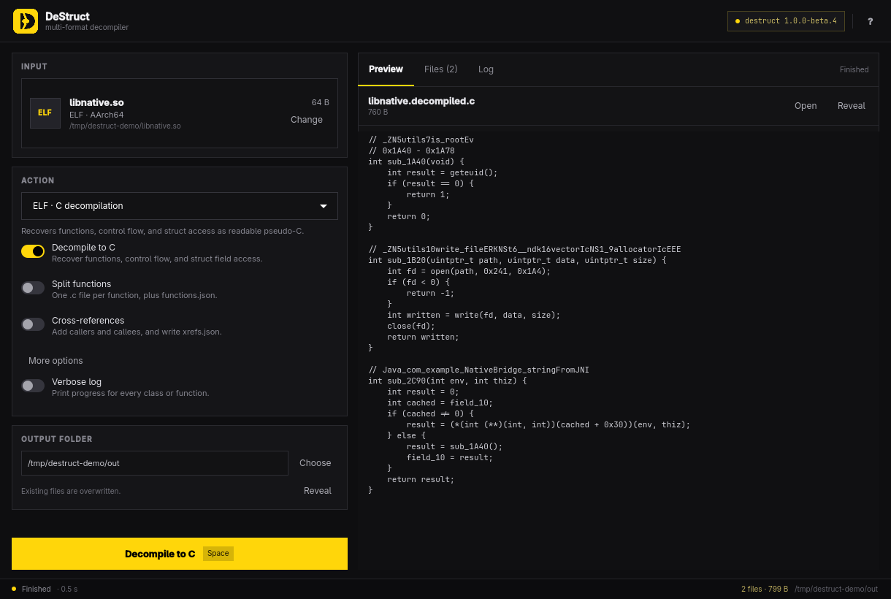

# DeStruct GUI

A keyboard-first desktop window for [DeStruct](https://github.com/NekoFemDev/DeStruct):
pick a file, let the app detect its format, adjust the options that matter,
and read the result inside the same window instead of bouncing between a
terminal and a text editor.



## What it does

- **Detects the format from the file** — JVM `.class`/`.jar`, Android
  `.dex`/`.apk`, Hermes `.hbc`/`.bundle`, Flutter `libapp.so`/APK, ELF
  `.so`/`.elf`, PE `.exe`/`.dll`, Unity IL2CPP (`global-metadata.dat` +
  `libil2cpp.so`), and JavaScript.
- **Shows only the options the command understands** — for AArch64 ELF that
  means decompile to C, split functions, cross-references, CFG simplification,
  LLVM IR, and IL2CPP field offsets; for JVM/DEX, deobfuscation; for IL2CPP, a
  second field for `global-metadata.dat`.
- **Runs `destruct` with a live log** — progress, errors, a real cancel button
  (SIGTERM first, then `kill` after four seconds), elapsed time, and a result
  summary.
- **Browses the output in place** — a flat, filterable file list instead of a
  folder tree, a monospaced preview for C/Java/JSON/`.hasm`, and buttons to
  open the file or the output folder externally.
- **Searches inside every output file** — type in the filter field and press
  Enter. Results are clickable and open the preview at the matching line.
  The scan runs in the background and does not freeze the window.
- **Follows Omarchy** — the accent and Hyprland's window rounding come from
  the current theme and update live. The interface language comes from Setup
  > Language, with Russian and English catalogs; other languages fall back to
  English string by string.
- **Works with mouse and keyboard** — drop a file anywhere in the window,
  `Ctrl+O`, `Space`, `?`, open a file from a file manager
  (`destruct-gui file.apk`), and the last eight successful runs are remembered.

## The `destruct` CLI

The GUI is a front end; the decompiler itself is the `destruct` binary. It
looks for it in this order:

1. the path you picked in the GUI (remembered in settings);
2. `/usr/bin/destruct`;
3. your `PATH`;
4. `/usr/local/bin/destruct`;
5. a local build made by the setup dialog under
   `~/.local/share/destruct/destruct-gui/DeStruct`.

If none is found, the first-run dialog offers two choices:

- **Download and build** — downloads the DeStruct source from GitHub and
  builds `destruct` into `~/.local/share/destruct/destruct-gui/DeStruct`.
  This needs `curl`, `tar`, `make`, Go, and a C compiler. The first build also
  downloads and compiles Capstone, so it can take a few minutes. The source
  and binary stay in that folder; the Go toolchain uses its usual module and
  build caches. This is the only network action, and it
  never starts without your click.
- **Choose binary...** — point the GUI at an existing `destruct` binary.


To build the CLI yourself instead:

```bash
cd /path/to/DeStruct
make build
```

Then use **Choose binary...** for `<your checkout>/destruct`, or install it
somewhere on `PATH`, for example `/usr/bin/destruct`.

## Build and install the GUI

Requires Arch Linux/Omarchy with `qt6-base`, `qt6-declarative`, `qt6-wayland`,
and `xdg-desktop-portal` (all present on Omarchy).

```bash
./bin/build         # → build/destruct-gui
./bin/test          # Qt tests: formats, argv, processes, search, theme, language, setup
./build/destruct-gui [file]
```

Install into the system and the app launcher:

```bash
./bin/install       # makepkg -fsi: /usr/bin, .desktop, icon
```

The installed app is called **DeStruct GUI** and appears in the Omarchy app
launcher (`Super + Space`). It also opens files from a file manager.

The GUI does not modify the DeStruct repository and does not depend on a
particular checkout location. Its PKGBUILD does not depend on a `destruct`
package because the CLI is not packaged in the Omarchy repositories yet.

## Keyboard shortcuts

| Keys | Action |
|---|---|
| `Ctrl+O` | Open a file |
| `Space` / `Ctrl+Enter` | Run the current action |
| `Esc` | Cancel the job or close an overlay |
| `Ctrl+F` | Focus the file filter |
| `Ctrl+1` / `Ctrl+2` / `Ctrl+3` | Preview / Files / Log |
| `Q` / `Ctrl+Q` | Quit (asks first if a job or setup is running) |
| `?` | Show every shortcut |

`Space` and `Q` stay out of the way while a text field has focus, so a space
in an output path or a `q` in a file name does not trigger an action. `Space`
also yields to a focused control such as the action picker.

## How it is put together

```
src/main.cpp            window, CLI arguments, QML context
src/backend.{h,cpp}     input, command line, QProcess, results, search
src/destructsetup.*     on-request source download and local build
src/formats.{h,cpp}     pure format sniffing and argv construction
src/filelistmodel.*     flat, filterable output file list
src/logmodel.*          live log and setup log
src/searchmodel.*       in-output search results
src/theme.*             Omarchy accent + Hyprland rounding
src/translator.*        Omarchy language, JSON catalogs, plural rules
src/portalfilepicker.*  file dialogs over XDG Desktop Portal
src/Main.qml            window, keys, layout
src/OptionsPanel.qml    action and command-specific options
src/FilesPane.qml       file filter and content search
src/PreviewPane.qml     text output preview
src/LogPane.qml         process log
src/SetupDialog.qml     first-run download/build/locate dialog
```

The GUI does not reimplement decompilation. It runs the `destruct` CLI through
`QProcess` with an argument array (no shell string concatenation), so every
existing and future DeStruct flag behaves exactly as it does in a terminal.

### Care with data

- The input file is never modified.
- `destruct` writes into the chosen output folder and overwrites matching files;
  the window says so next to the output field.
- Quitting during a job or a setup build asks first.
- Cancel sends SIGTERM so the CLI can finish cleanly, then `kill` after four
  seconds.
- The preview reads at most 2 MB per file and refuses paths outside the output
  folder.
- Setup downloads into the app's own data directory and removes its temporary
  files on failure or cancellation. The Go toolchain uses its usual module and
  build caches.

## Limitations

- Hermes `--decompile` is disabled in the current DeStruct version. The GUI
  shows the `.hasm` assembly and points to `destruct assemble` in a terminal.
- C decompilation is AArch64-only. Other architectures remain raw
  disassembly, and the toggle explains why it is disabled.
- `destruct hex` and the interactive REPL stay terminal tools: they are
  command-driven editors rather than batch jobs.
- The setup build is intentionally simple: latest `main`, system toolchain,
  no sandbox. If the build fails, the complete log is shown in the dialog.

## License

MIT. The theme watcher, translator, and XDG portal file picker are adapted
from [Omacut](https://github.com/omacom-io/omacut) (MIT, David Heinemeier
Hansson); the attribution is kept in [LICENSE](LICENSE).
